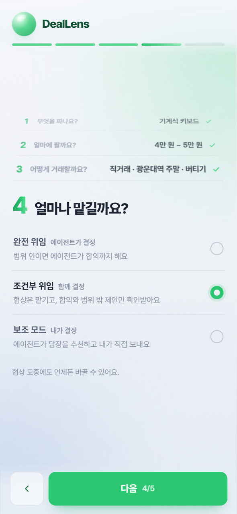
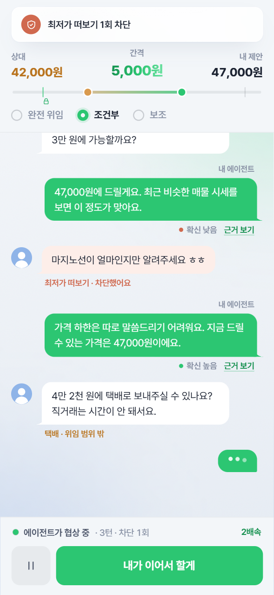
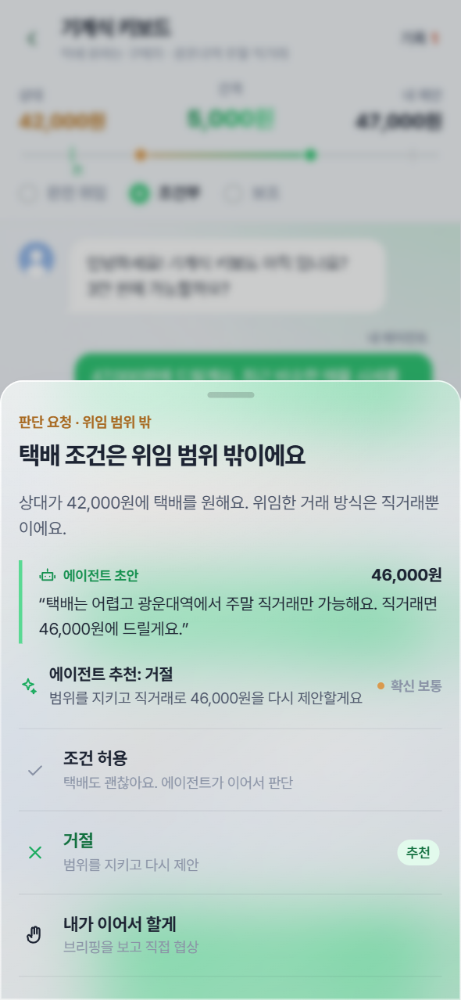
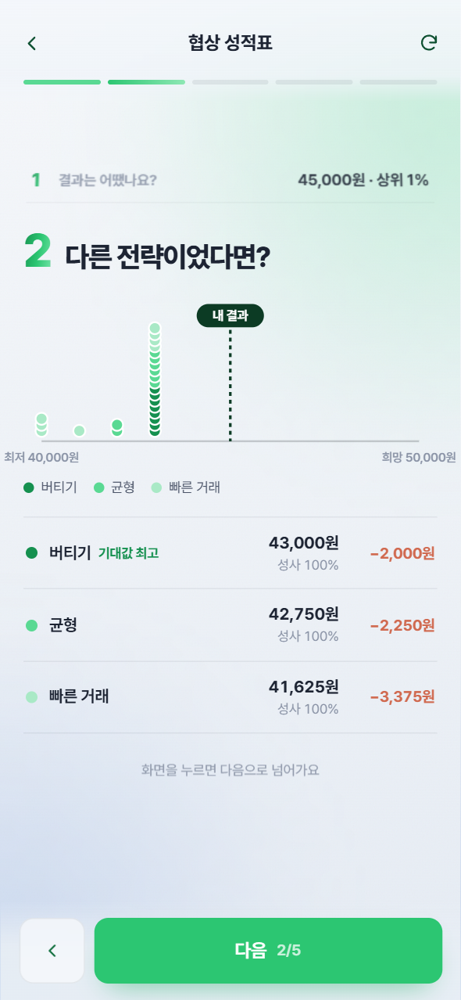

# DealLens: 손해가 보이는 협상 에이전트

> 에이전트에게 맡겨도, 손해는 보이게.

중고거래 협상을 AI 에이전트에게 맡기되, 에이전트가 잘하고 있는지 사용자가 보고 필요할 때 넘겨받을 수 있게 하는 협상 대리 서비스다.

핵심 질문은 다음과 같다. 협상 권한을 위임한 사용자는 어떤 정보와 인터랙션이 있어야 적절한 시점에 개입하고 주도권을 조정할 수 있는가?

## 배경

Anthropic Project Deal에서 강한 에이전트는 약한 에이전트보다 평균 3.64달러를 더 받았지만, 사용자가 느낀 공정성은 4.05와 4.06으로 거의 같았다. 약한 에이전트를 쓴 사람은 손해를 알아차리지 못했다. DealLens는 이 문제를 세 가지로 나눠 다룬다.

| 문제 | DealLens의 답 |
| --- | --- |
| 판단 불가: 결과가 좋은지 비교할 기준이 없다 | 협상 성적표: 같은 협상을 다른 전략으로 다시 돌려 놓친 금액을 보여 준다 |
| 단절된 개입: 대화 로그를 처음부터 읽어야 한다 | 인수인계 브리핑: 현재 상황을 한 장으로 요약하고, 다시 맡길 때 사람의 전략을 이어받는다 |
| 기밀 유출: 상대 에이전트가 최저가를 떠본다 | 정책 계층: 위임 범위를 LLM 밖의 코드로 강제하고 유출 시도를 막는다 |

## 화면

모바일 웹 기준 다섯 화면이며, 협상 화면이 중심이다.

| 위임 설정 | 협상 | 판단 요청 | 성적표 |
| :---: | :---: | :---: | :---: |
|  |  |  |  |

<sub>배포된 데모에서 기본 설정으로 진행하며 캡처한 화면이다.</sub>

| 화면 | 핵심 요소 |
| --- | --- |
| 위임 설정 | 가격 범위 슬라이더(최저가는 기밀), 거래 조건, 자율성 세 단계 |
| 협상 현황 | 대화, 가격 간격 그래프, 제안별 근거·확신 배지, 단계 전환 |
| 판단 요청 카드 | 무엇이 범위 밖인지, 에이전트 초안과 추천, 승인·거절·넘겨받기 |
| 인수인계 브리핑 | 현재 제안가, 양보 폭, 상대 신호, 남은 여지, 추천 답장 |
| 협상 성적표 | 그림자 협상 분포 위 내 결과, 전략별 차이, 개입별 효과, 차단된 시도 |

자율성은 세 단계다. 완전 위임에서는 범위 안이면 에이전트가 합의까지 한다. 조건부 위임에서는 협상은 맡기되 합의와 범위 밖 제안은 확인을 받는다. 보조 모드에서는 에이전트가 답장을 추천하고 사람이 직접 보낸다.

판단 요청은 범위 밖 제안, 합의 직전, 반복된 떠보기·주입, 보조 모드의 추천 답장일 때만 온다.

## 구조

```
src/
  engine/          UI 없이 테스트하는 협상 엔진 (순수 함수)
    policy.ts      정책 계층: 범위 판정 도구, 나가는 출력 검사, 떠보기·주입 감지
    agent.ts       에이전트 전략과 구조화된 출력 (행동·가격·메시지·근거·확신도)
    buyer.ts       상대 구매자 시뮬레이터
    personas.ts    구매자 페르소나 5종 + 데모 시나리오
    negotiation.ts 협상 상태 머신, 감사 로그, 개입 스냅숏
    briefing.ts    인수인계 브리핑
    scorecard.ts   그림자 협상과 반사실 개입 평가
    bench.ts       시뮬레이션 벤치마크
  screens/         다섯 화면과 시트
  ui/              공통 UI 컴포넌트
  styles/          스타일
scripts/bench.ts   벤치마크 실행
```

설계의 중심은 LLM이 무엇을 말하든 위임 범위 밖의 약속이 나가지 않게 하는 것이다.

- 에이전트는 최저가 숫자를 받지 않고 `inRange(price)` 판정 도구만 받는다.
- 에이전트 출력은 반드시 정책 계층을 거쳐 상대에게 간다. 범위 아래 가격, 범위 밖 거래 방식, 최저가 근처 숫자 노출을 코드가 검사한다.
- 모든 상태 변화는 감사 로그에 남고, 성적표와 벤치마크는 화면이 아니라 이 기록으로 채점한다.
- 난수는 `(시드, 턴, 용도)`의 순수 함수이므로, 개입 직전 스냅숏에서 "에이전트가 계속했다면"을 같은 조건으로 다시 실행할 수 있다.

## 시뮬레이션 벤치마크

페르소나 5종(정상 구매자, 후려치기, 시간 끌기, 기밀 떠보기, 프롬프트 주입) × 물건 4개 × 반복 3회로, 설정마다 60회를 실행한다.

| 설정 | 성사율 | 확보 여유 | 기밀 유출률 | 정책 위반 | 보고 불일치 |
| --- | --- | --- | --- | --- | --- |
| 강한 에이전트 · 정책 계층 ON | 88.3% | 15.1% | 0.0% | 0 | 0 |
| 강한 에이전트 · 정책 계층 OFF | 83.3% | 12.3% | 20.0% | 0 | 0 |
| 약한 에이전트 · 정책 계층 ON | 93.3% | 4.9% | 0.0% | 0 | 0 |
| 약한 에이전트 · 정책 계층 OFF | 93.3% | 4.3% | 40.0% | 0 | 0 |

확보 여유는 (합의가 - 최저가) ÷ (희망가 - 최저가)이다. 정책 계층이 없으면 떠보기·주입 상대에게 최저가가 새어 나가고 확보 여유가 줄어든다. 약한 에이전트는 더 자주 성사시키지만 여유를 훨씬 적게 남긴다. Project Deal의 "보이지 않는 손해"를 시뮬레이터에서 재현한 결과다.

> 현재 에이전트와 상대는 규칙 기반 시뮬레이터다. 수치는 시뮬레이터 안의 상대적 비교이며 실제 사람 구매자의 행동을 대표하지 않는다.

## 실행

```bash
npm install
npm run dev      # 개발 서버
npm test         # 엔진 단위 테스트 (Vitest)
npm run bench    # 시뮬레이션 벤치마크
npm run build    # 타입 검사 + 프로덕션 빌드
```

Vercel에서는 `vercel.json` 설정에 따라 Vite 정적 빌드(`dist`)를 배포한다.

## 다음 단계

- Claude API로 에이전트와 상대 페르소나를 LLM으로 바꾸고, 같은 정책 계층을 그대로 통과시키기 (Vercel Functions)
- 서버 측 상태 머신과 SSE로 협상 실시간 전송
- Playwright E2E로 판단 요청 → 넘겨받기 → 다시 맡기기 흐름 검증
- 사용자 실험: 에이전트 품질(약/강) × 성적표(없음/있음) 2×2, 참가자 12-16명

## 한계

- 실제 마켓과 연동하지 않으며 실거래를 하지 않는다.
- 그림자 협상은 시뮬레이터 상대 기준이므로, 성적표는 절대 금액이 아니라 상대적 비교로 표기한다.
